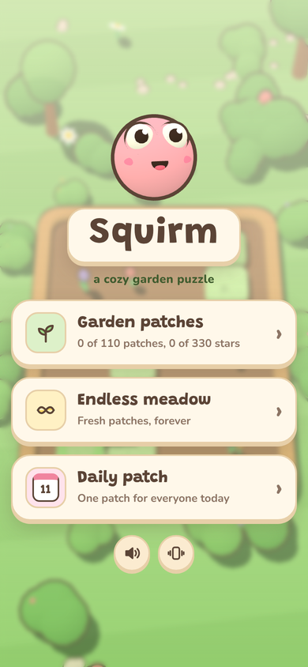
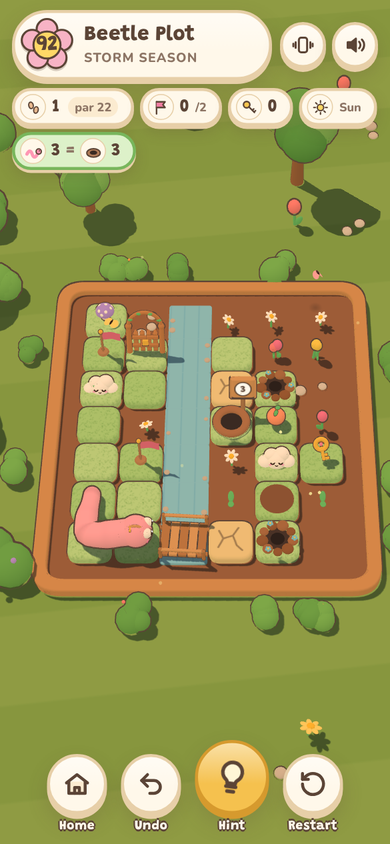

# Squirm

[](https://github.com/farzinmirzaie/squirm/actions/workflows/deploy.yml)

A cozy, turn-based worm puzzle set in a 2.5D garden. Crawl a fixed-length worm through
garden patches, touch every flag, and slip into the burrow at exactly the right length.

**Play it at <https://farzinmirzaie.github.io/squirm/>.** It installs as an app and plays offline.

<p align="center"> </p>

- 130 patches in 13 chapters, each introducing one mechanic
- Endless mode with generated, solver-checked patches (easy / medium / hard)
- A daily patch that's the same for everyone, with stars, streaks, hints and undo
- Badges to earn, hats to unlock, gentle generated music, haptics and synthesized sound (no audio or image files)
- Swipe, tap or use the keyboard: arrows/WASD to crawl, `Z` undo, `R` restart, `H` hint, `M` mute, `Esc` back

## How to play

Each patch is a small grid of grass tiles. Swipe (or use the arrow keys) to crawl one tile at a
time; the worm keeps its length as it moves and can't reverse into its own body. Touch every
flag, then crawl into the burrow at exactly the length shown on its sign.

New garden helpers and hazards arrive chapter by chapter: peaches and mushrooms change your
length, dry patches sink once you leave them, keys open gates, tunnels connect, cloud stones
toggle rain (seedlings grow, puddles fill), cranks swing bridges, snails get in the way,
flowers hold hedges open while you rest on them, and wet leaves send you sliding.
Finish a patch in par moves for three stars; stuck? Undo, restart, or ask for a hint.

## Develop

Requires Node 20 or newer.

```
npm install          # three.js and the two fonts, which are self-hosted in the build
npm run build        # src/ + public/ -> dist/
npm run serve        # serve dist/ locally
npm run verify       # check every level is solvable, pars are correct, pacing is right
npm run analyze      # print par, state count and winnable % for every level
npm test             # rule unit tests + level checks + build
npm run smoke        # play patch 1 in headless Chromium (npx playwright install chromium first)
```

Every push to `master` is verified, built and deployed to GitHub Pages by
[`.github/workflows/deploy.yml`](.github/workflows/deploy.yml) (Pages source: **GitHub Actions**).

### Adding levels

Levels live in [`src/levels.js`](src/levels.js) as small ASCII maps (the character legend is in
[`CLAUDE.md`](CLAUDE.md)). Every level must be solvable with `par` equal to the shortest
solution, and each mechanic first appears in its own chapter; `npm run verify` checks both.
Once deployed, installed copies of the game pick up new levels on their own.

See [`CLAUDE.md`](CLAUDE.md) for architecture, the level format and conventions.

## Credits

- [three.js](https://threejs.org/) r128 (MIT)
- [Grandstander](https://github.com/Etcetera-Type-Co/Grandstander) and
  [Nunito](https://github.com/googlefonts/nunito) fonts (SIL Open Font License 1.1), via
  [Fontsource](https://fontsource.org/)

## License

MIT. See [LICENSE](LICENSE).
