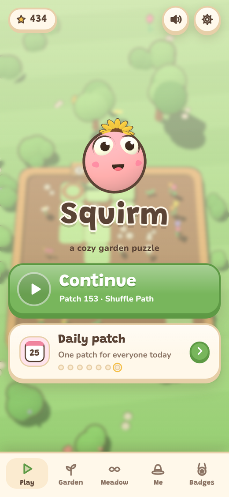
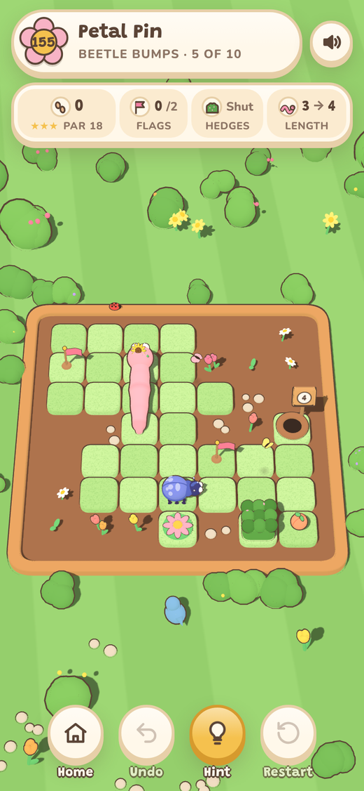
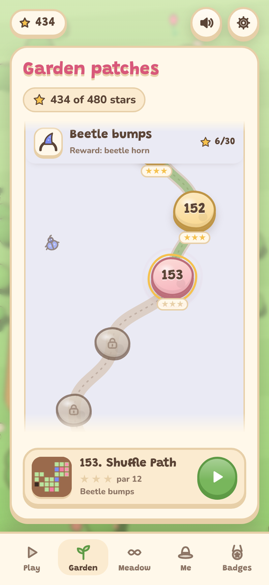
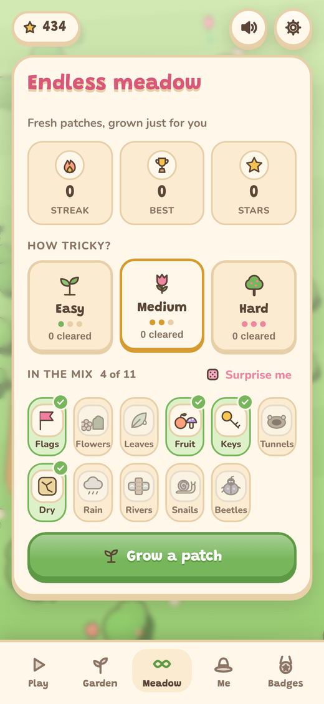
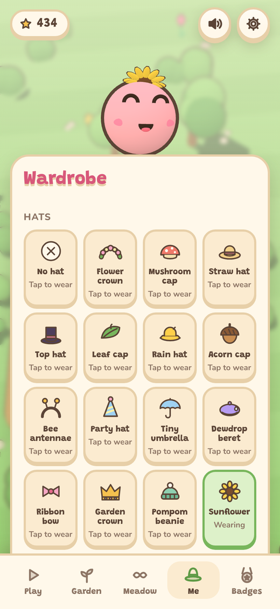
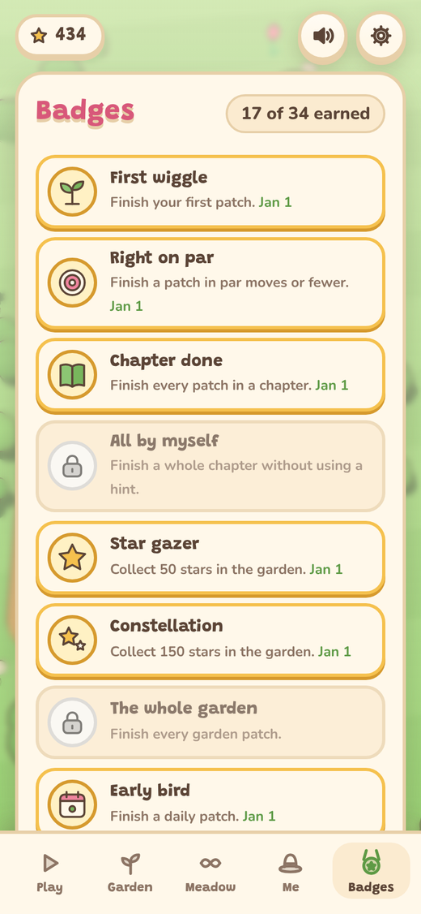
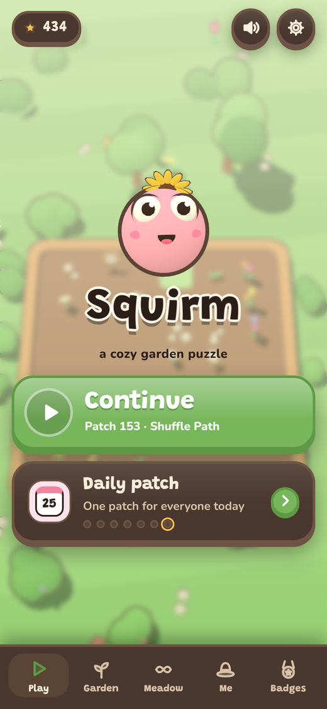
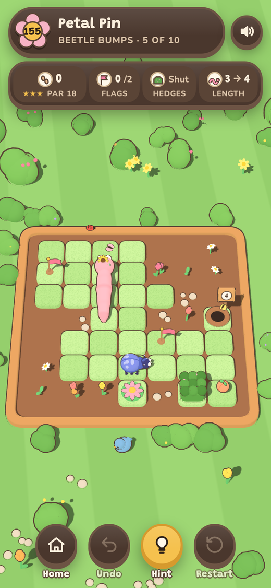

# Squirm

[](https://github.com/farzinmirzaie/squirm/actions/workflows/deploy.yml)

A cozy, turn-based worm puzzle set in a little 3D garden. Steer a fixed-length worm through
garden patches, touch every flag, and slip into the burrow at exactly the right length.

**Play it at <https://farzinmirzaie.github.io/squirm/>.** It installs as an app and plays fully offline.

<p align="center">
  
  
  
</p>
<p align="center">
  
  
  
</p>
<p align="center">
  
  
</p>

## Features

- **160 hand-made patches in 16 chapters.** Each chapter introduces one mechanic gently, and a
  few mixed chapters combine them at rising difficulty. Every patch is checked by a solver, and
  par is always the shortest solution.
- **A garden map** where patches are stepping stones on a winding path, with a preview of each patch.
- **Endless meadow:** fresh generated patches at easy, medium or hard, with the mechanics you pick.
- **A daily patch** that's the same for everyone, with streaks and an optional daily reminder.
- **Stars, 35 badges and a hat for every chapter**, plus worm colours and patterns (stripes,
  spots, a soft fade, a rainbow tail) to unlock.
- **Undo, restart and hints.** A built-in solver points the way when you're stuck.
- **Gentle generated music** and synthesized sound, haptics, light and dark themes, and reduced
  motion support.
- **No downloads at runtime.** Every 3D model is built in code and every sound is synthesized,
  so the game has no image or audio assets.
- Swipe, tap or use the keyboard: arrows/WASD to crawl, `Z` undo, `R` restart, `H` hint,
  `M` mute, `Esc` back.

## How to play

Each patch is a small grid of grass tiles. Swipe to crawl one tile at a time. The worm keeps its
length as it moves and can't reverse into its own body. Touch every flag, then crawl into the
burrow at exactly the length shown on its sign. Finish in par moves for three stars.

New things arrive chapter by chapter:

| Chapter | What's new |
|---|---|
| 1 First sprouts | crawling to the burrow, then flags |
| 2 Snack time | peaches make you longer, mushrooms shorter |
| 3 Cracked earth | dry patches sink once you leave them |
| 4 Garden gates | each key opens one gate |
| 5 Tunnels | crawl in one, pop out of its twin |
| 6 Rainy days | cloud stones toggle rain: seedlings grow, puddles fill |
| 7 Riverside | rivers, bridges you cross along their planks, and a crank that swings them |
| 8-10 | mixes of everything so far |
| 11 Snail trail | snails slide one tile every move |
| 12 Hedge garden | hedges open while you rest on a flower button |
| 13 Dewy morning | wet leaves send you sliding |
| 14-15 | mixes of the late mechanics, then everything |
| 16 Beetle bumps | push beetles around, even onto flower buttons |

## Develop

Requires Node 22 or newer (CI uses the version in [`.nvmrc`](.nvmrc)).

```
npm install          # three.js and the two fonts, which are self-hosted in the build
npm run build        # src/ + public/ -> dist/
npm run serve        # serve dist/ locally (npm run serve -- --port 8080 --base /squirm/)
npm test             # rule unit tests + level checks + build
npm run smoke        # play patch 1 in headless Chromium (needs Playwright's Chromium)
npm run check        # npm test + smoke; run this before pushing
npm run verify       # check every level is solvable, pars are correct, pacing is right
npm run analyze      # print par, state count and winnable % for every level
```

There's no bundler and no framework. [`tools/build.js`](tools/build.js) joins the page shell, the
game rules, the levels and the game code into one `index.html`, copies three.js r128 and the
fonts next to it, and writes a service worker that precaches everything.

```
src/shell.html   markup and all CSS
src/logic.js     pure game rules, shared by the game, the hint solver and the tools
src/levels.js    the 160 patches as small ASCII maps
src/game.js      rendering, input, UI, audio, the endless generator and the solver
src/sw.js        service worker template
public/          manifest, icons and install screenshots
tools/           build, local server, level verification, analysis and curation
test/            rule and generator unit tests, and a headless smoke test
```

Every push to `master` is tested, built and deployed to GitHub Pages by
[`.github/workflows/deploy.yml`](.github/workflows/deploy.yml). Installed copies pick up the new
version on their own.

### Adding levels or mechanics

Levels live in [`src/levels.js`](src/levels.js) as small ASCII maps. Every level must be
solvable, its `par` must equal the shortest solution, and each mechanic first appears in its own
chapter. `npm run verify` checks all of that.

[`CLAUDE.md`](CLAUDE.md) is the full guide to the architecture, the level format and its
character legend, the checklist for adding a mechanic, and the UI conventions. It's written for
AI coding agents and works just as well for people.

## Credits

- [three.js](https://threejs.org/) r128 (MIT)
- [Grandstander](https://github.com/Etcetera-Type-Co/Grandstander) and
  [Nunito](https://github.com/googlefonts/nunito) fonts (SIL Open Font License 1.1), via
  [Fontsource](https://fontsource.org/)

## License

MIT. See [LICENSE](LICENSE).
